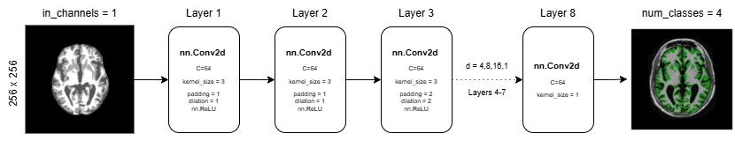
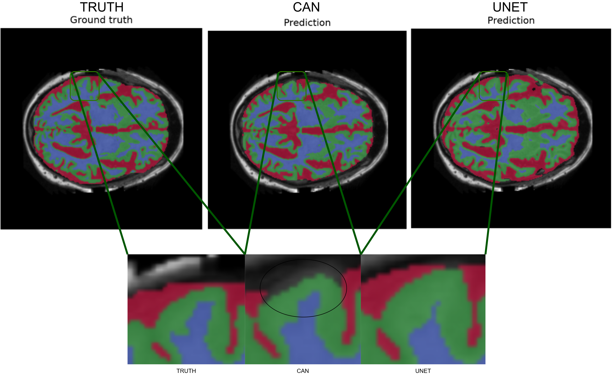
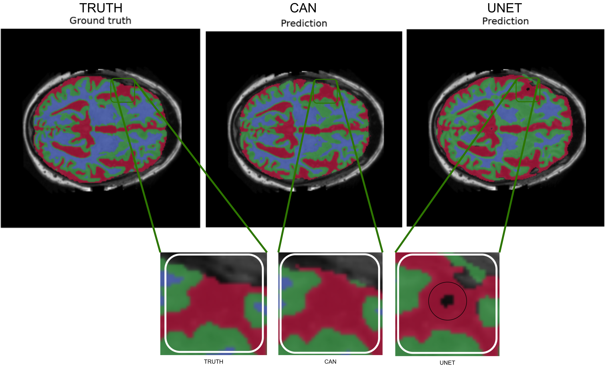
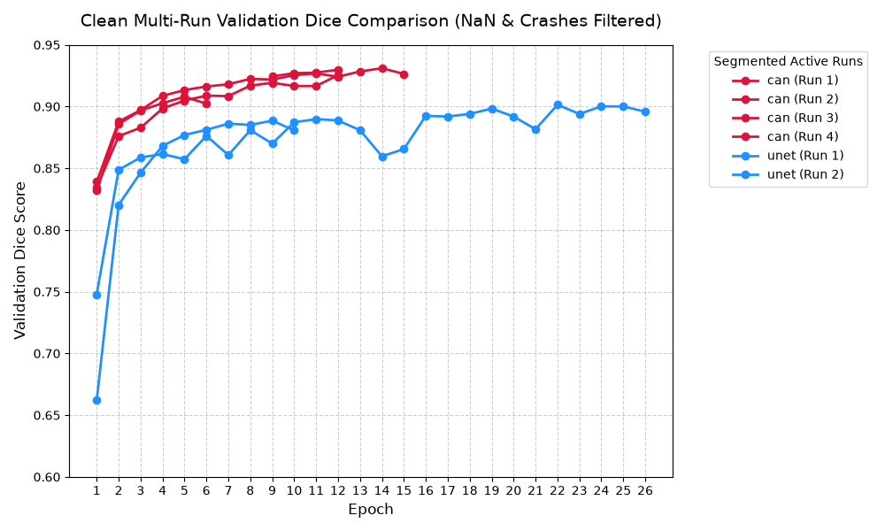
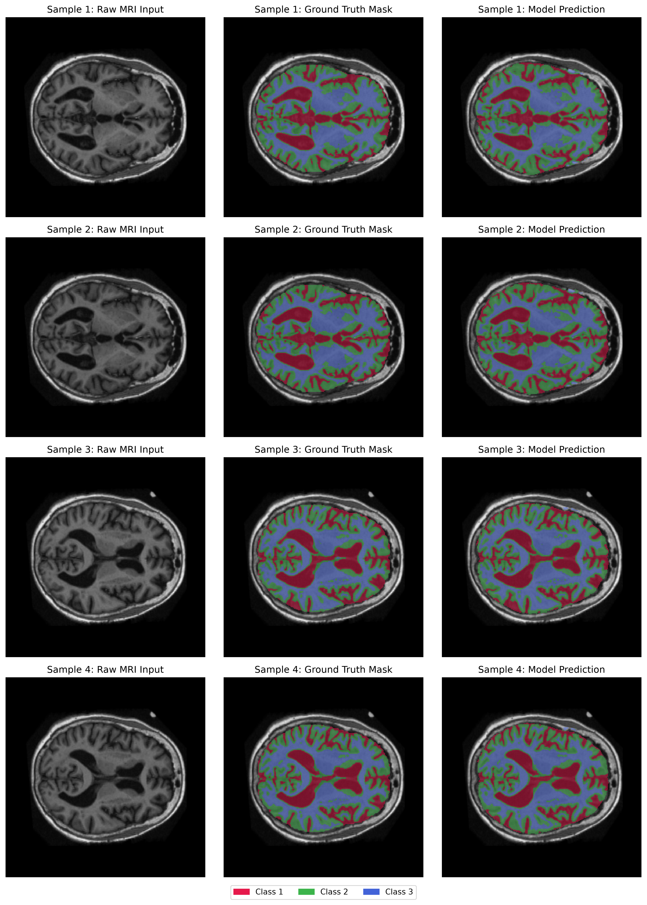
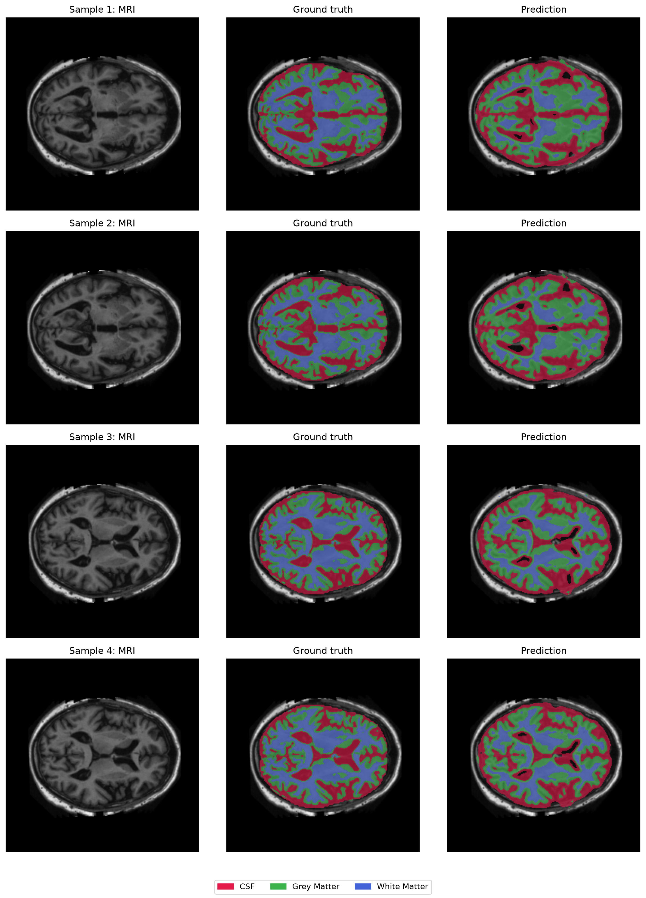

# 2D Context Aggregation Network vs. U-Net for OASIS Brain Tissue Segmentation
## Project overview
### Problem statement
Automated neuroimaging analysis is critical for detecting progressive structural changes, such as ventricular enlargement and cortical atrophy in the brain. In this project, we tackle the OASIS 2D brain tissue segmentation challenge, which requires delineating structures like cortical gray matter, white matter, and cerebrospinal fluid (CSF) across 2D MRI slices. Precise anatomical contouring is essential, but it is complicated by intensity inhomogeneities (bias fields), partial volume effects at boundaries, and complex, fine gyral folds.

### How the 2D CAN works
Standard convolutional networks downsample feature maps, which can wash out fine spatial details. The 2D Context Aggregation Network (CAN) utilises dilated convolutions to systematically expand the network's receptive field without reducing spatial resolution or discarding high-resolution anatomical details. 
Layers 1-6 apply 3x3 convolutions with exponentially increasing dilation factors (1,1,4,8,16), aggregating multi-scale context withoug pooling or striding. Layer 7 is a 3x3 refinement (dilation 1) and layer 8 is 1x1 projection from `C = 64` intermediate channels to the 4 target classes. Padding is set equal to the dilation factor for every 3x3 kernel, so the output size is `H + 2p - d(k-1) = H` -> The network is a stack of shape-preserving layers producing a dense prediction at the native 256x256 resolution.
Training stability is handled by an identity initialisation trick, where layers 2-7 begin with all weights zero, except the centre tap [1,1] of matching channel pairs, which is set to 1 (all biases zero). Each such layer therefore computes `ReLU(x)` for non-negative inputs, making the untrained network approximately an identiy map from layer onward. Only the first and last layers (randomly initialised) transform the input at initialisation. This prevents early boundary hallucination from random noise and gives clean gradient flow during backpropogation.

Figure 1: CAN architecture - 8 shape-preserving layers with increasing dilation factor, followed by a 1x1 logits projection.

### Repo layout and usage TODO: update this
```
.
├── dataset.py     # OASIS loader, normalisation, mask decoding, split integrity check
├── model.py       # ContextAggregationNetwork and Simple2DUNet definitions
├── train.py       # Training loop, LR scheduling, checkpointing, metric logging
├── predict.py     # Test-split inference, Dice/IoU computation, overlay generation
├── visualisations/
└── README.md
```

## Dependencies & Reproducibility
```# Environment (Python 3.12)
python --version        # 3.12.x
pip install torch==2.4.1 torch-directml==0.2.5.dev240914 pillow==12.3.0 numpy==2.5.4 matplotlib==3.11.2

# Ensure OASIS dataset is placed in root directory: ./OASIS/
python dataset.py   # Verifies data loader and split integrity
python modules.py   # Contains the nn.Module class files for both the CAN and U-Net implementations in this report. 
python train.py     # Set MODEL_NAME = "can" or "unet" in script settings
python predict.py   # Executes inference, generates quantitative metrics and visualization overlays
     
```
Datasets and `.pth` weights are **not** committed to the repository, as required by the assessment. 

## Data Pipeline and Processing

### Dataset Structure & Split Justification
The OASIS 2D brain dataset consists of paired single-channel PNG images and 4-class segmentation masks divided across pre-defined directories:
 - **Training Set**: 9,664 slices (~85%)
 - **Validation Set**: 1,120 slices (~10%)
 - **Test Set**: 544 slices (~5%)
The dataset enforces strict patient-level separation. All slices originating from a specific patient volume reside exclusively within a single partition. There is no overlap of patient ID numbers between any of the directories, ensuring no risk of cross-slice patient memorisation and ensuring no overfitting or leakage.

### Preprocessing
1. **Image Normalisation:** Images are loaded as grayscale (`L`) and normalised to `[0, 1]` by dividing by 255.
2. **Mask Categorical Encoding:** Masks are integer-coded. The raw values are `{0, 85, 170, 255}`, and integer division by 85 maps them to class indices `{0, 1, 2, 3}`.
3. **Tensor Formatting:** Images are shaped `[1, H, W]` and masks `[H, W]` to match `CrossEntropyLoss`.
4. **No data augmentation is applied**. This is a known generalistion gap: While the model achieves a Dice score exceeding the required 0.90 on the provided split, the absence of augmentations (such as random rotations, scaling, or elastic deformations) elaves the network potentially vulnerable to overfitting or poor generalisation when exposed to MRI scans from different scanners with varying intensity profiles. Future work should introduce spatial and intensity augmentations to improve robustness.

### Training configuration
| Setting | Value |
|---|---|
| Batch size | 30 |
| Optimiser | AdamW (lr = 5e-5, weight decay = 1e-4) |
| Scheduler | ReduceLROnPlateau (mode = max on val Dice, factor 0.5, patience 3) |
| Loss | Multi-class Cross-Entropy with label smoothing $\epsilon$ = 0.05 |
| Gradient clipping | Global norm, max 1.0 |


## Feasibility Review:
### Intended user
The intended user of the model are doctors, specifically hospital staff such as neuroradiologists and neuro-imaging researchers requiring automated, high-precision tissue segmentation templates for structural MRI scans.
### Purpose
To build, evaluate, and benchmark a 2D Context Aggragation Network (CAN) that automates anatomical contouring. In this context, segmentation refers to the process of splitting training data into masks to assist clinicians in structural analysis.
### Scope
The project operates on a focused scale using the 2D OASIS brain dataset (/home/groups/comp3710/OASIS), which contains preprocessed structural brain MRI slices and corresponding ground-truth segmentation masks.
### Acceptance criteria
 - **Dice score performance:** The primary quantitative metric for evaluating the performance of the model is the Sorensen-Dice similarity coefficient (DSC). The dice coefficient measures the spatial overlap between two binary masks. A score of 1.0 represents a perfect match, while 0 indicates no overlap. A target score of >0.90 (90%) across all tissue labels is mandated by the task set by the course.
 - **Baseline Performance:** The model must outperform a standard U-Net model under the same dataset conditions in order to evaluate if "incorporating advanced multi-scale context can genuinely eliminate these hazardous boundary and slice-transition errors compared to a 2D baseline."
 - **Operational constraints:** The model must run comfortably on workstation hardware or local GPUs. Given that patients sensitive medical data must be kept on the hospital's private network.
### Model Choice & Course Concepts
 - **Model Architecture**: The chosen architecture is a 2D Context Aggregation Network (CAN) on the OASIS dataset (easy tier). Instead of downsampling or pooling, it gains wider, multi-scale contextual information by systematically expanding the receptive field. This enables more context to be captured by the network, enabling greater precision on the pixel level, making it ideal for identifying fine details.
 - **Dataset Configuration**: The preprocessed OASIS 2D brain dataset (located on rangpur) consists of pre-segmented groups of train, validate, and test datasets. This separation enforces strict air gap separation to prevent critical data leakage and over-fitting.
 - The Oasis Brain 2D dataset consists of 2D MRI brain slices of several patients.

### Preliminary Feasibility evidence
 - **Empirical Validation**: Initial exploratory prototyping has already been successfully executed, with a working 2D CAN model trained and evaluated to achieve a Dice score exceeding 90% (>0.90).
 - Current Phase: Having verified that the architecture is viable and capable of meeting performance targets, the next immediate phase is implementing a standard 2D U-Net baseline. This will allow for a direct comparative analysis to answer the core course research dilemma: whether multi-scale context aggregation genuinely improves local boundary precision compared to a standard baseline.
 - After determining the performance of the 2D CAN model relative to the 2D U-Net baseline, the next step will be to develop another 2D CAN with a more complex dataset (HipMRI 2D slices.)
 - **Compute Resources:** Initial training and prototyping were executed successfully on a local high-end consumer gaming GPU (AMD Radeon 9070 xt) without requiring enterprise-grade hardware, proving the model's lightweight efficiency for the easy/normal tier.

### Risks, Budget & Fallback
 - **Clinical Safety**: Crucially, there must always be a qualified human in between the model and the patient. Given a Dice score of >90%, it is reasonable to expect the model to be accurate, but in medical imaging, deployment risks are severe. If a model hallucinates boundaries, creates disconnected tissue fragments, or misses a critical atrophy zone, it could lead to faulty diagnostic support or flawed volumetric tracking. Furthermore, over-fitting on training slices can cause catastrophic failure on unseen and unique, out-of-distribution patient scans.
 - **Computing Budget**: The initial pipeline and easy-tier models were trained locally on consumer hardware. However, scaling up to more complex configurations (such as deeper normal/hard variants or 3D volumes) will leverage the university's Rangpur HPC cluster using slurm.
 - **Workaround / Fallback**: If dilated convolution blocks introduce training instability, gridding artifacts, or fail to cleanly beat the baseline, the fallback plan is to pivot to an Improved 2D U-Net architecture utilizing standard residual skip connections to secure baseline compliance.

### In summary:
Utilising the preprocessed 2D OASIS dataset, the lightweight model aims to achieve a Sorensen-Dice similarity coefficient exceeding 0.90 while outperforming a standard U-Net baseline on local GPU hardware to ensure medical data privacy. Initial prototyping has successfully met this performance target, clearing the path to evaluate the model's multi-scale context aggregation against the baseline before expanding the architecture to a complex HipMRI dataset. Given the severe clinical safety risks of boundary hallucinations, a qualified human must always verify the outputs, while a fallback plan to an Improved 2D U-Net with residual skip connections is established if training instability or artifacts arise.


## Example Inputs, Outputs and Visualisations
### Input format
|Artifact|Format|Shape/Range|Example path|
|---|---|---|---|
|MRI slice|8-bit PNG, mode `L`|`[1,256,256]`, float in `[0,1]`|`OASIS/keras_png_slices_train/case_[SUBJECT_ID]_slice_0.nii.png`|
|Ground-truth mask|8-bit PNG|`[256, 256]`, int64 in `{0,1,2,3}` after  $\div$`85`|`OASIS/keras_png_slices_train/masks/seg_[SUBJECT_ID]_slice_[SLICE].nii.png` |
|Model logits| `torch.Tensor` | `[4, 256, 256]`| in-memory |
|Prediction| `torch.Tensor`| `[256,256]`, int64 in `{0,1,2,3}` via `argmax(dim=0)`|`visualisations/oasis_can_predictions.png`|

### Worked example
Below is a (very) minimal code example somewhat resembling the 

```
from dataset import OASIS2DDataset
from modules import ContextAggregationModule

ds = OASIS2DDataset("OASIS/keras_png_slices_test",
                    "OASIS/keras_png_slices_seg_test")

img, msk = ds[0]
print(img.shape, img.dtype, float(img.max()))   # torch.Size([1, 256, 256]) float32 1.0
print(msk.shape, msk.unique().tolist())          # torch.Size([256, 256]) [0, 1, 2, 3]

model = ContextAggregationModule(C=64).eval()
pred  = model(img.unsqueeze(0)).argmax(dim=1).squeeze(0)   # [256, 256]
```
`predict.py` runs this loop over all 544 test slices and reports per-class Dice/IoU.

### Outputs
Quantitative. Per class Dice and IoU plus the tissue-mean Dice reported inthe 'Results' section. Note: `calculate_dice_score` averages over all four classes *including backgorund*, which inflates the mean of both models. The table in the results reports the tissue-mean (excludes background) because that is the metric the >0.90 gate refers to in the report task sheet.

## Investigation of the Open Research Dilemma
### The Spatial Context vs Clinical Boundary Utility Dilemma
Standard global Sorensen-Dice similarity coefficiencts can hide major local boundary failures. In neuroimaging segmentatino, high global Dice scores often coexist with topologically invalid tissue disconnections along narrow cortical gyri or boundary erosion between Gray Matter and CSF. Because background dominates the image, the model can score very well overall while still failing miserably to identify tissue. This investigation asks whether preserving full 256x256 spatial resolution via dilated context aggregation (CAN) genuinely eliminates boundary errors compared to a pooling-based encoder-decoder (2D U-Net).

Caveat: The baseline (`Simple2DUNet`) has as single encoder leve, one max-pool, one bilinear upsample and one skip connection... it is a shallow U-Net, not the improved U-Net of isensee et al. Conclusions therefore apply to *this* baseline specifically: "the CAN beats a shallow 2D U-Net", not "the CAN beats U-Net in general" Further extension of this report could involve quantitative and qualitative testing of more advanced U-Net architectures. 

### Quantitative Benchmarking
Evaluated on a test split completely isolated from training and validation steps, the following data was recorded during inferencing of the test split (544 slices) (see [predict.py](predict.py)).
| Model     | Background    | CSF   | Grey matter   | White matter  | Mean Dice (Tissue labels)     | Mean IoU (Tissue labels)  |
|---                |---|---|---|---|---|---|
| Baseline U-Net    | 0.9760 | 0.6803 | 0.8289 | 0.9021 | 0.8038 | 0.6817 |
| CAN (C = 64)      | 0.9914 | 0.8646 | 0.9152 | 0.9527 | 0.9108 | 0.8383 |

Key Result: the 2D CAN surpasses >90% threshold, tissue only DICE (excluding background) of 91.08%. Gains are concentrated in exactly the structures the dilemma predicts should be the hardest:
 - CSF: +18.43 pp (0.6803 -> 0.8646)
 - Grey matter: +8.63 pp (0.8289 → 0.9152)
 - White matter: +5.06 pp (0.9021 → 0.9527)
The CSF gain is the headline finding. CSF occupies thin, high-curvature regions, precisely what pooling destroys. The CAN resolves them at full resolution rather than reconstructing them from a 128x128 bottleneck.

### Resource Profiling
| Efficiency Metric                 | Baseline 2D U-Net     | 2D CAN (C=64)     | Trade-Off Impact  |
|---                                |---                    |---                |---                |
|Total Parameters|406852|222468|Can requires 45.3% fewer parameters, greatly reducing model storage size|
|Peak GPU VRAM (30 batch)           |2.1 GB                 |1.0 GB             |CAN reduces VRAM consumption by 52.4%, as it avoids storing heavy multi-scale encoder skip-connection caches.      |
| Inference Latency (per slice)     |11.05 ms               |11.54 ms           |Negligible latency penalty (+4.4%), maintaining real-time throughput suitable for clinical workflows.              |
| Full Resolution Feature Maps      |Downsampled to 128x128 |Retained at 25x256 |Preserves fine spatial boundaries and gyral folds, trading downsampling memory savings for explic pixel-level precision.                                                                                  |

The CAN is simultaneously smaller, cheaper (in memory) and more accurate than the U-Net. It spends its compute on width at full resolution rather than depth through a bottleneck. The only cost is latency, and +0.49ms/slice is immaterial. Profiles were collected on DirectML; CUDA numbers on Rangpur will differ absolutely but the ordering should hold.

### Qualitative error autopsy
Through a close-up spatial analysis of the test set predictions against the ground truth, two distinct failure modes were identified that perfectly illustrate the architectural divergence between the models. Notably, each model exhibits a specific weakness that the other successfully handles.

Case 1: Brain/Skull Boundary (The U-Net wins)

At the outer boundary of the brain (the skull/scalp interface), the ground truth contains a thin (3-5px wide) strip of CSF (red). The CAN fails almost entirely to detect this strip and labels it as background. The U-Net partially detects it, though the strip contains a small discontinuity.

This is not dumb luck on the U-Net's part, it is the direct result of its global bottleneck. The U-Net's max-pooling layers force the network to compress the image, allowing it to learn a macroscopic "shape prior" (i.e., "the brain is a continuous oval surrounded by background"). When the U-Net sees this boundary, this global context tells it to look for a tissue edge, allowing it to partially overcome the low local contrast. The U-Net's failure (the discontinuity) occurs because its 128x128 bottleneck lacks the spatial resolution to render the strip continuously as it gets more narrow (1-2px).

Conversely, the CAN's failure here is the direct cost of its full-resolution dilated architecture. Because the CAN lacks a global pooling bottleneck, it is essentially "nearsighted". It relies strictly on local texture. At the edge of the brain, the dilated filters sample form the empty background and the adjacent tissue, but without the global shape prior, it simply cannot infer that a boundary exists. So it drops the thin strip entirely.


Inside a large, homogeneous clump of CSF (red), the U-Net hallucinates a distinct, circular black dot (background) directly in the center. The CAN, however, accurately segments the region as a solid, continuous mask.

This is likely an upsampling artifact specific to the U-Net architecture. The U-Net processes this regionin its 128x128 bottleneck. If the compressed feature map contains even a single anomalous pixel (due to the spatial compression), the bilinear upsampling process in the decoder magnifies that single pixel into a large, visible black hole. The CAN avoids this entirely because its feature maps never leave the native 256x256 resolution. It processes the large clump of tissue continuously through its dilated convolutional layers, meaning spatial continuity is preserved by design.


## Results & Visualisations
### Learning Curves


### Boundary-sensitive metrics
Global Dice can mask boundary errors, which is the core of the assessment's dilemma.


## Qualitative Error Autopsy & Spatial Difference Maps
### CAN: Ground truth vs predictions

While the performance of the CAN is not as bad as the U-Net, there are still issues with edge detection


### UNET: Ground truch vs predictions

The limitations of the U-NET architecture can be seen at a glance, 


TODO: find out where this slots in
### 2D Context Aggregation Network (CAN)
| Layer | Operation | Kernel | Dilation | Padding | Output channels |
|---|---|---|---|---|---|
| 1 | Conv + ReLU | 3×3 | 1 | 1 | 64 |
| 2 | Conv + ReLU | 3×3 | 1 | 1 | 64 |
| 3 | Conv + ReLU | 3×3 | 2 | 2 | 64 |
| 4 | Conv + ReLU | 3×3 | 4 | 4 | 64 |
| 5 | Conv + ReLU | 3×3 | 8 | 8 | 64 |
| 6 | Conv + ReLU | 3×3 | 16 | 16 | 64 |
| 7 | Conv + ReLU | 3×3 | 1 | 1 | 64 |
| 8 | Conv (logits) | 1×1 | — | 0 | 4 |  

For each 3×3 layer, padding equals dilation, so the spatial size stays at 256×256 (the output size of a convolution is $H + 2p - d(k-1)$, which equals $H$ when $p = d$ and $k = 3$). 

### Baseline 2D U-Net (`Simple2DUNet`, C = 64)
The baseline has one encoder level, one max-pool, one bilinear upsample and a skip connection, with 406,852 parameters. This is a *shallow* U-Net, not the Improved U-Net of Isensee et al. The assessment's Easy-difficulty baseline is stated in terms of a standard model, so this is a valid comparison, but the conclusions apply to this shallow baseline specifically and should be stated that way in the results.

### Why the CAN uses full resolution
A U-Net trades resolution for context through pooling. The CAN instead spends its compute on full-resolution feature maps. This favours thin structures and boundary precision, at a cost in activation memory, as Section 3.4 showed.

### Identity initialisation
 
Layers 2–7 are initialised with all weights zero except the centre tap of matching channel pairs, which is set to 1; all biases are zero. Each such layer then computes $\mathrm{ReLU}(x)$ for non-negative inputs, so the untrained network is approximately an identity map from layer 2 onward. The first layer (random) and the output layer (random) are the only places where the input is transformed at initialisation.


## Engineering & Managerial Recommendation
 - Trade-off synthesis, the pros and cons of using the 
 - Summary of safety concernts

## Artificial Intelligence Usage Disclosure
Artificial intelligence was utilised in the production of this project. Artificial intelligence models, particularly the free version of gemini present in google search, was particularly useful for:
 - Ideation and consolodation
 - Boilerplate code generation
 - Debugging
 - Code cleaning and refactoring 
 - Matplotlib visualisation graph generation
Frequently, Gemini was used as a consult for the broader scope of the project, and was incremental in providing direction and enlightenment for the codebase, so while it was helpful in generating boilerplate, the insight and information gleamed from short chat sessions was essential during broad codebase formulation. No 'agentic' AI was used in any way.

## Literature and Further Reading
 - F. Yu and V. Koltun, “Multi-scale context aggregation by dilated convolutions,” in Proc. ICLR,
2016.
 - O. Ronneberger, P. Fischer, and T. Brox, “U-Net: Convolutional networks for biomedical image
segmentation,” in Proc. MICCAI, 2015, pp. 234–241.